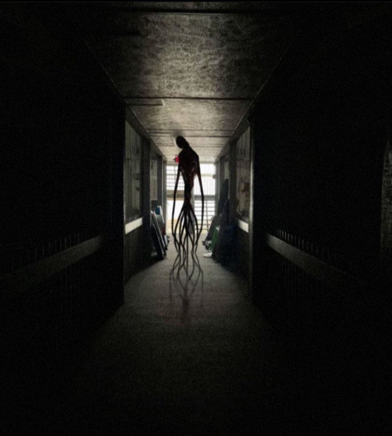

# Periscope Depth

Lest she backslide into complacency—lest, after so many cycles spent alone, she start to forget that she isn’t―Aki watches those last few moments Viktor recorded before Abaddon vanished into _Eriophora_’s broken depths. There it was, finally exposed: something that could barely be bothered to imitate, something whose haphazard humanoid shape was more obscenity than accommodation. A plastic slime mold walking on legs that weren’t legs; arms that weren’t arms extending into _Eri_’s guts like invading mycelia. It watched the approaching ’spores with all the concern of a shark eyeing a minnow, manifested that impenetrable wall of spines far too fast for the eye to follow. It seemed to extrude those needles almost as an afterthought―like someone swatting reflexively at a fly without even consciously registering the fact.

She replays it, a masochistic ritual, whenever she’s about to sleep. _This is what you’re up against_, she reminds herself. _It doesn’t hate you. It doesn’t hunt you. It doesn’t even know you exist, and the truly terrifying thing is it wouldn’t matter if it did. You are nothing to it. It could step on you like a bug without noticing―or, noticing, it wouldn’t bother to scrape you off its heel. This is what Viktor Heinwald has put you up against. Eriophora is nothing but fodder for this thing, an instrument wielded in service to an agenda you can’t begin to understand, and you’re all that stands in its way._

_So, hey. Good luck with that._

### \* \* \*

She catches Chimp talking to it sometimes. He’s talking to it _right now_.

It’s possible they converse all the time, of course, exchanging petabytes in the blink of an eye. More likely the monster interrogates and Chimp merely answers like an obedient dog, serving up whatever projections or telemetry Abaddon is interested in at any given moment. They might never stop talking around her, down silent tightbeams, through networks of fiberop infesting the walls like capillary beds.

But sometimes Chimp talks aloud in the darkness, at merely human speeds, in some tongue no human ever spoke. It may have been English in the distant past—now and then Aki catches syllables that might once have been _kilopascal_ or _isograv_—but if so, it’s long-since metastasized into haunting sibilant gibberish. It echos down unlit corridors where convenient pickups send it upstream to her lampreys. It talks over the hums and hisses of working machinery in parts of the ship finally coming back to life after uncounted centuries offline.

And now—statistically impossible as it may be, that the only two ships in this endless labyrinth might just happen to pass in the night—the Chimp speaks in tongues on one side of a bulkhead while Aki cowers on the other, mere centimeters away.

She crouches frozen, terrified that even the slightest motion might give her away. She breathes small fast breaths that barely touch her diaphragm; she swears her knees are rattling loud as castanets. Telemetry bundled with past recordings has occasionally reported a transient drop in air temperature—a rolling atmospheric chill, as if Chimp were following some frozen ghost drifting through the catacombs―but here, now, the sensors insist the temperature is rock-steady. They must be malfunctioning. Aki’s blood is freezing in her arteries.

Wetness trickles along her thigh.

Eventually the Chimp falls silent. Abaddon does not answer. Aki has never heard Abaddon answer. Maybe Chimp isn’t talking to it after all. Maybe he’s hallucinating. Maybe this isn’t even anything new, maybe it’s how he’s always passed the long lonely ages when no one’s on deck. Maybe Chimp has an imaginary friend.

Maybe he’s just going insane.

Much later—after five or ten kilosecs, when she screws up enough courage to pop the panel a crack and slip a periscope through the grille—of course there’s nothing there at all. She crawls back to her lair and plays Heinwald’s sizzle reel a dozen times over, to atone for her cowardice.